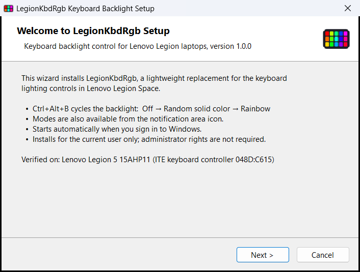

# LegionKbdRgb

A tiny, dependency-free replacement for the keyboard backlight controls in **Lenovo Legion Space**.

Removing Legion Space also stops **Fn+Space** from changing the keyboard RGB lighting. LegionKbdRgb brings that control back with a global hotkey and a tray icon. It is a single ~60 KB executable that uses almost no CPU, has no background services and no telemetry, and does not need administrator rights.



## Features

- **Ctrl+Alt+B** cycles the backlight: **Off → Random solid color → Rainbow → Off**
  - *Random solid color* picks a new vivid color every time.
  - *Rainbow* smoothly cycles through the hue wheel every 8 seconds.
- A notification-area (tray) icon: left-click selects the next mode; right-click opens a menu to pick a mode or exit.
- The last mode is remembered across sign-out and reboot.
- Starts automatically at sign-in through a per-user Task Scheduler task. The task also runs on battery and has no time limit.
- A standard Windows installer:
  - a setup wizard;
  - an entry under *Settings → Apps → Installed apps*, with **Modify** (repair) and **Uninstall**;
  - a silent uninstall option.

## Compatibility

| Status | Hardware |
|---|---|
| ✅ Verified | Lenovo **Legion 5 15AHP11** (83Q7, 2026), keyboard controller **ITE 048D:C615**, single-zone RGB |
| 🟡 Likely | Other Legion / LOQ models whose ITE keyboard controller (VID `048D`) exposes a standard HID **LampArray** collection (usage page `0x59`) |
| ❌ Not supported | Older 4-zone Legion keyboards (PIDs `C9xx`, 33-byte `0xCC` protocol). Use [L5P-Keyboard-RGB](https://github.com/4JX/L5P-Keyboard-RGB) or [LenovoLegionToolkit](https://github.com/LenovoLegionToolkit-Team/LenovoLegionToolkit) instead. |

To check whether your laptop exposes a LampArray device, run this in PowerShell:

```powershell
Get-PnpDevice -PresentOnly | Where-Object InstanceId -match 'VID_048D' | Select-Object FriendlyName, InstanceId
```

Then check that **Settings → Personalization → Dynamic Lighting** lists your keyboard. If it does, LegionKbdRgb will very likely work. Reports for other models are welcome: please open an issue with your model name and the output above.

Requirements: Windows 10 1809 or later, or Windows 11. The required .NET Framework 4.8 is built into Windows.

## Installation

### Option A: build the installer (about 10 seconds, no SDK needed)

Windows ships the C# compiler that is needed, so no Visual Studio or .NET SDK is required.

```powershell
git clone https://github.com/nodi-inc/utils-legion-keyboard-rgb.git
cd utils-legion-keyboard-rgb
powershell -ExecutionPolicy Bypass -File build.ps1
```

Then run `dist\LegionKbdRgb-Setup-<version>.exe`.

### Option B: prebuilt installer

Download `LegionKbdRgb-Setup-<version>.exe` from the [latest release](https://github.com/nodi-inc/utils-legion-keyboard-rgb/releases/latest). Each release lists the SHA-256 hash of the installer so you can verify the download.

> **Unsigned binary.** The installer is not code-signed. **Microsoft Defender SmartScreen** may show "Windows protected your PC"; choose *More info → Run anyway*. **Smart App Control** may also block downloaded unsigned executables. If it does, build the installer locally with Option A.

### What the installer does

| Item | Location |
|---|---|
| Program files | `%LOCALAPPDATA%\Programs\LegionKbdRgb\` (`LegionKbdRgb.exe`, `uninstall.exe`, `state.txt`) |
| Autostart | Task Scheduler → `LegionKbdRgb` (at sign-in, current user, least privilege) |
| Uninstall entry | `HKCU\Software\Microsoft\Windows\CurrentVersion\Uninstall\LegionKbdRgb` |
| Shortcut (optional) | Start menu → *LegionKbdRgb Keyboard Backlight* |

Nothing is written outside your user profile, and no administrator rights are requested.

## Uninstall and repair

- **Settings → Apps → Installed apps → LegionKbdRgb Keyboard Backlight → ⋯**
  - **Modify** repairs or reinstalls the application.
  - **Uninstall** removes it.
- Running the setup executable again also opens the repair / remove screen.
- Silent uninstall:
  ```
  "%LOCALAPPDATA%\Programs\LegionKbdRgb\uninstall.exe" /uninstall /quiet
  ```

After removal, the keyboard returns to the lighting profile stored in its firmware.

### Setup command-line options

| Option | Effect |
|---|---|
| *(none)* | Opens the install wizard, or the maintenance screen if the application is already installed |
| `/install` | Opens the install wizard even if the application is already installed (for example, to change the location) |
| `/repair` | Opens the maintenance screen |
| `/uninstall` | Asks for confirmation, then removes the application |
| `/uninstall /quiet` | Removes the application without any UI |

## How it works

These notes come from investigating the Legion 5 15AHP11. They may help anyone working on similar hardware.

- **Fn+Space is invisible to Windows.** With Legion Space removed, pressing Fn+Space produced nothing on any channel that was monitored:
  - the Lenovo WMI event classes in `root\WMI`, including `LENOVO_LIGHTING_EVENT`, `LENOVO_GAMEZONE_LIGHT_PROFILE_CHANGE_EVENT` and `LENOVO_UTILITY_EVENT`;
  - the vendor HID input collections of the keyboard controller.

  The key is handled entirely in firmware, so a regular hotkey (Ctrl+Alt+B) is used instead.
- **The keyboard controller (ITE 048D:C615)** has two relevant interfaces:
  - **MI_00**: vendor collections on usage page `0xFF89`. Usage `0x07` takes 960-byte feature reports that follow the Lenovo "Spectrum" protocol.
    - The controller answers queries such as the key map and the active profile.
    - Profile switching (`0xC8`) works.
    - Per-key direct writes ("Aurora", `0xD0`/`0xA1`) and brightness writes (`0xCE`) are accepted but have **no visible effect** on this single-zone model.
  - **MI_01**: a standard **HID LampArray** collection (usage page `0x59`) with **one lamp**. Windows *Dynamic Lighting* uses this interface, and so does LegionKbdRgb.
- **What LegionKbdRgb sends:**
  - `LampArrayControl` (report `6`) with `AutonomousMode = 0`, which takes control from the firmware;
  - `LampRangeUpdate` (report `5`) to set every lamp to the same color.

  Dynamic Lighting can take control back, so the current state is re-applied every 5 seconds. The Rainbow mode streams updates at about 30 fps.
- **On exit**, LegionKbdRgb sets `AutonomousMode = 1`, which hands the keyboard back to the firmware.

## Building

`build.ps1` uses `csc.exe` from the .NET Framework 4 that ships with Windows (`%WINDIR%\Microsoft.NET\Framework64\v4.0.30319`). It:

1. compiles the tray application `LegionKbdRgb.exe`;
2. compiles the installer and embeds the application in it, producing `dist/LegionKbdRgb-Setup-<version>.exe`.

The build runs no executable other than the signed Windows compiler. This matters when Smart App Control is on, because it may block freshly compiled helper tools.

The version number is set in `src/Version.cs`.

| Path | Purpose |
|---|---|
| `src/KbdRgb.cs` | Tray application: hotkey, modes, color animation, LampArray output |
| `src/hidutil.cs` | HID device enumeration and feature-report helpers (SetupAPI / hid.dll P/Invoke) |
| `src/setup/Setup.cs` | Installer wizard. A copy is installed as `uninstall.exe` and also handles repair and removal |
| `src/app.ico` | Application icon (committed) |
| `src/tools/MakeIcon.cs`, `make-icon.ps1` | Icon generator; run `make-icon.ps1` to regenerate `src/app.ico` |
| `src/app.manifest` | asInvoker / DPI-aware manifest shared by both executables |

## Troubleshooting

- **Nothing happens when I press Ctrl+Alt+B.**
  - Check that the tray icon is present.
  - If another application already owns the hotkey, LegionKbdRgb shows a message at startup. Modes can still be changed from the tray icon.
- **The keyboard briefly flashes another color.** Windows Dynamic Lighting is reclaiming the device. Turning off *Settings → Personalization → Dynamic Lighting → Use Dynamic Lighting on my devices* avoids this.
- **The color is not restored after sleep.** The state is re-applied within 5 seconds of resume. If it is still wrong, run *Modify → Repair* from Installed apps.
- **The installer is blocked.** See the note about unsigned binaries under [Installation](#installation).

## Acknowledgements

Protocol research was informed by [LenovoLegionToolkit](https://github.com/LenovoLegionToolkit-Team/LenovoLegionToolkit), [L5P-Keyboard-RGB](https://github.com/4JX/L5P-Keyboard-RGB), [LegionAura](https://github.com/Nivedck/LegionAura) and [OpenRGB](https://gitlab.com/CalcProgrammer1/OpenRGB). No code from these projects is included.

## Disclaimer

This project is not affiliated with, endorsed by, or supported by Lenovo. "Lenovo", "Legion" and "Legion Space" are trademarks of Lenovo. Use at your own risk.

## License

[MIT](LICENSE)
